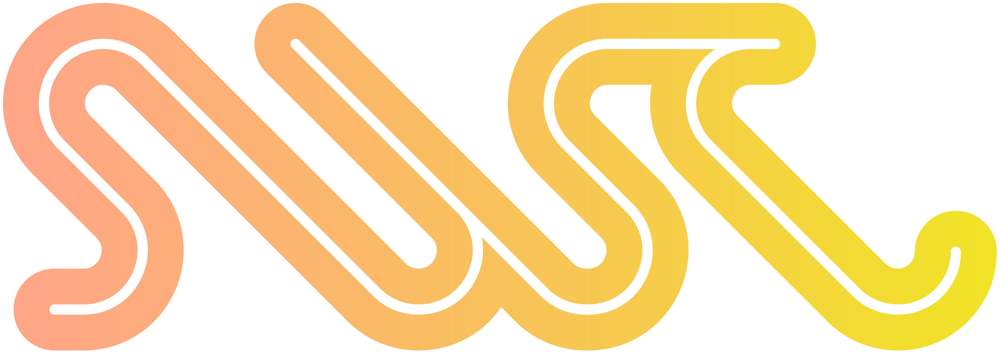

<p align="center">
  <a href="https://swc.rs/">
    
  </a>
</p>

<p align="center">
  <a href="https://discord.com/invite/GnHbXTdZz6"></a>
  <a href="https://www.npmjs.com/package/@swc-next/core"></a>
  <a href="https://crates.io/crates/swc_next_ecma_parser"></a>
  <a href="./LICENSE"></a>
</p>

# SWC Next

SWC Next is a fast JavaScript and TypeScript toolchain written in Rust. It is a rewrite of [SWC](https://github.com/swc-project/swc) from the ground up, built around a flat, ESTree-based AST for performance and extensibility.

- **Performance:** **Up to 3× faster than SWC** in [native parser benchmarks](https://github.com/SoonIter/ecmascript-parser-benchmark-native) and **up to 10× faster** in [JavaScript API benchmarks](https://github.com/SoonIter/ecmascript-parser-benchmark-js).
- **JavaScript Extensibility:** Fast AST round trips between Rust and JavaScript enable writing plugins in JavaScript.
- **Correctness:** Tested against Test262, TypeScript, and Babel, supplemented by additional unit tests.

The Rust API is still in a very early stage; please continue to use SWC's Rust API for production.

## Usage

The JavaScript API is available from [`@swc-next/core`](npm/core). Install it with `npm install @swc-next/core`:

```sh
npm install @swc-next/core
```

Then parse and print a program:

```js
import { parseSync, printSync } from "@swc-next/core";

const { program, diagnostics } = parseSync("const answer = 42;");
console.log(diagnostics);
console.log(printSync(program).code);
```

## Roadmap

As a ground-up rewrite, SWC Next is being developed in a separate repository and published as separate packages. We are gradually bringing its capabilities in line with SWC, with the long-term goal of becoming SWC's next major version and merging back into the SWC repository.

See the [project roadmap](https://github.com/swc-project/swc-next/issues/181) for planned milestones and progress.

## Design & Architecture

See the [Flattening AST design](https://next.swc.rs/architecture/flat-ast) and other documents.

## Rust API Soundness

The current Rust AST API has known soundness issues:

- Node IDs and typed handles are not tied to their owning `Ast`. Using a handle with a different AST can access unrelated nodes or cause undefined behavior through unchecked access, even through safe APIs.

## Compatibility

SWC Next plans to support selected SWC [`.swcrc` options](https://swc.rs/docs/configuration/swcrc). Its Rust and JavaScript APIs will not be compatible with SWC's.

Configuration compatibility has not been implemented yet.

## Powered by

<table>
  <tr>
    <td width="320" height="112" align="center" valign="middle">
      <a href="https://jb.gg/OpenSourceSupport">
        
      </a>
    </td>
    <td width="320" height="112" align="center" valign="middle">
      <a href="https://codspeed.io/?utm_source=oss-sponsorship&utm_medium=swc-project">
        <picture>
          <source media="(prefers-color-scheme: dark)" srcset="https://codspeed.io/codspeed-logo-dark.svg">
          <source media="(prefers-color-scheme: light)" srcset="https://codspeed.io/codspeed-logo-light.svg">
          
        </picture>
      </a>
    </td>
  </tr>
</table>

## Sponsors

<p align="center">
  <a href="https://opencollective.com/swc">
    
  </a>
</p>

## Credits

Thanks to:

- [Yuku](https://github.com/yuku-toolchain/yuku), whose AST definitions, parser, and semantic analysis were ported to Rust and adapted for SWC Next.
- The [Zig](https://codeberg.org/ziglang/zig) compiler and [rowan](https://github.com/rust-analyzer/rowan), which inspire the flattening AST design.
- [Oxc](https://github.com/oxc-project/oxc), whose arena hash collections, regular expression parser, and portions of isolated-declarations logic and conformance test infrastructure were copied or adapted for SWC Next. Its AST tooling also informs our design.
- [esbuild](https://github.com/evanw/esbuild), whose printer implementation and portions of its test suite were ported from Go to Rust and adapted for SWC Next.

## License

SWC Next's own code is licensed under the Apache License, Version 2.0, as is [SWC](https://github.com/swc-project/swc). Included third-party code and data retain their upstream license terms; see [THIRD_PARTY_NOTICES](THIRD_PARTY_NOTICES).

See the [LICENSE](LICENSE) file for more details.
