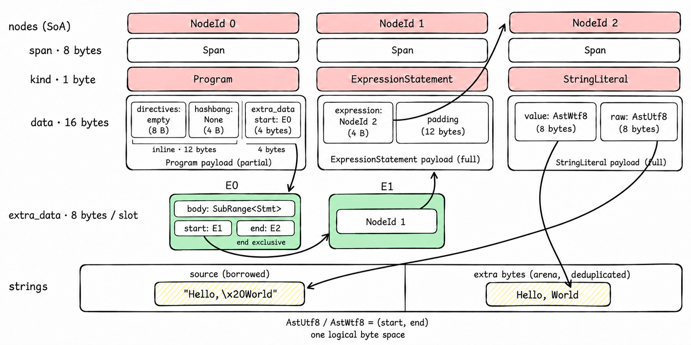

## Flattening AST

The core idea of flattening AST can be found in https://www.cs.cornell.edu/~asampson/blog/flattening.html

In summary, the main idea is to use a single data structure to represent the entire AST, instead of using a tree structure. This can be done by using a vector to store all the nodes, and refer to them by their index (NodeId).

- **Pros:** Better performance because of less memory consumption and memory locality.
- **Cons:** Less ergonomic API

### Detailed Design

There are two parts of the AST design: universal (untyped) abstract syntax node for storage, and typed ASTs for ergonomic and compatible API.

#### Universal AST

This part of design is heavily inspired by [zig compiler](https://codeberg.org/ziglang/zig) and [the corresponding blog](https://mitchellh.com/zig/parser).

First, the AST context stores everything about the AST, where all CRUD should happen. Each one is an arena:

```rs
pub struct Ast {
    nodes: IndexVec<NodeId, AstNode>,
    extra_data: IndexVec<ExtraDataId, ExtraData>,
    bigint: IndexVec<BigIntId, BigIntValue>,
    string_allocator: StringAllocator,
}
```

The `AstNode` stores the kind of the node (1 byte enum), and the data of the node, which represents the start index of extra data (fields) of the node.

```rs
assert!(size_of::<AstNode>() == 16);
pub struct AstNode {
    span: Span,         // 8 bytes
    kind: NodeKind,     // 1 bytes
    data: NodeData,     // 4 bytes
}
```

Since difference kinds of AST nodes are heterogeneous, which means they have difference kinds and lengths of fields, we cannot store their fields in a single typed data struct like `Vec<T>`.

`NodeData` is basically the start index of extra data.

```rs
pub union NodeData {
    empty: (),
    extra_data_start: ExtraDataId,
}
```

`ExtraData` is a type-erased, canonical 64-bit word used for node fields that do
not fit in the inline payload. The AST schema supplies the field type, and
`ExtraDataValue` defines how that type is encoded and decoded.

- For data smaller than 8 bytes, such as `bool` and `number`, they are directly stored in the `ExtraData`.
- For data larger than 8 bytes, such as `BigIntValue`, `ExtraData` stores their Ids, while their values are stored in another typed arena of AST context.
- For data with undetermined length, such as `SubRange<Expr>`, their start and end `ExtraDataId` values are packed into `ExtraData`.

```rs
assert!(size_of::<ExtraData>() == 8);
#[repr(transparent)]
pub struct ExtraData(u64);

pub trait ExtraDataValue: Sized {
    fn into_extra_data(self) -> ExtraData;
    unsafe fn from_extra_data(data: ExtraData) -> Self;
}
```



No runtime discriminant is needed because each node kind has a fixed schema.
AST node handles share blanket `ExtraDataValue` implementations instead of
generating identical conversions for every concrete node type.

#### Typed AST

This part of design is inspired by [rowan](https://github.com/rust-analyzer/rowan).

The universal AST is hard to use, and has no compatibility with legacy SWC at all. Therefore typed AST is proposed. All of them are just typed wrappers of `NodeId` or `AstNode`.

What `#[ast]` macro in the following example does is only to make the definition wrapper of `NodeId`. Other useful functions and builders are generated by `ast_tools`.

```rs
#[ast]
pub struct Module {
    body: SubRange<ModuleItem>,
    shebang: OptionalAtomRef,
}

// Macro expand
pub struct Module(NodeId)
```

For the typed AST of `enum`, the macro keeps the definition unchanged.

#### Ast Tool

This part of design is inspired by [rowan](https://github.com/rust-analyzer/rowan) and [oxc](https://github.com/oxc-project/oxc).

The ast tool scans all definition of typed AST, collects their fields and generates everything useful, such as builders, getters/setters, visitors, and more.

The builder functions are used for creating new typed AST nodes.

- The names are either same as the struct names or the enum name concated with their variant names.
- The params are the fields of the struct.
- The builder adds each param to the extra data list of the AST context, and finally adds the universal AST node with corresponding `NodeKind` and the first extra data index. Finally, it wraps the returnt `NodeId` with the typed AST wrapper.

```rs
impl Ast {
    #[inline]
    pub fn module(&mut self, span: Span, body: SubRange<ModuleItem>, shebang: OptionalUtf8Ref) -> Module {
        let _f0 = self.add_extra(body);
        let _f1 = self.add_extra(shebang);
        Module(self.add_node(AstNode {
            span,
            kind: NodeKind::Module,
            data: NodeData {
                extra_data_start: _f0,
            },
        }))
    }
}
```

The ast tool also generates the field getters and setters like:

```rs
impl Module {
    #[inline]
    pub fn shebang(&self, ast: &crate::Ast) -> OptionalAtomRef {
        debug_assert!(self.0 < ast.nodes.len());
        let offset = unsafe { ast.nodes.as_raw_slice().get_unchecked(self.0.index()).data.extra_data_start} + 1usize;

        debug_assert!(offset < ast.extra_data.len());
        let ret = unsafe { ast.extra_data.as_raw_slice().get_unchecked(offset.index()).optional_atom };
        ret.into()
    }

    #[inline]
    pub fn set_shebang(&self, ast: &mut crate::Ast, shebang: OptionalAtomRef) {
        debug_assert!(self.0 < ast.nodes.len());
        let offset = unsafe { ast.nodes.as_raw_slice().get_unchecked(self.0.index()).data.extra_data_start} + 1usize;

        debug_assert!(offset < ast.extra_data.len());
        unsafe { ast.extra_data.as_raw_slice_mut().get_unchecked_mut(offset.index()).optional_atom = shebang.into() };
    }
}
```

The `offset` is calculated with the `NodeData` (which is the start index of extra data), and the relative number of the field defined in the struct.

The safety of these functions are guaranteed by the typed AST wrapper, which ensures that the offset is always valid and the extra data is always of the correct type.

### API diff

The parser returns the AST context with its typed root stored on it:

```rs
let result = Parser::init(&allocator, source, options, config).parse();

let ast = result.ast;
let program = ast.root_program();
```

As is said above, all typed ASTs are just typed wrappers of `NodeId`. Therefore it's impossble to directly access the properties from them. Instead, Getter and setter functions are needed with AST context.

```rs
// swc: Directly property acccess
let expr = paren_expr.expr;
match program {
  Program::Module(Module { span, body, shebang }) => { ... },
  _ => { ... }
}

paren_expr.expr = Expr::Invalid(...)

// SWC Next: use getters and setters with the reference to AST context
let expr = paren_expr.expr(&ast);
match program {
  Program::Module(module) => {
      let span = module.span(&ast);
      let body = module.body(&ast);
      let shebang = module.shebang(&ast);
  },
  _ => { ... }
}

paren_expr.set_expr(
    &mut ast,
    Expr::Invalid(...)
);
```

For visitors, it's not hard to think of the implementation with the AST context passed throught the visit functions:

```rs
impl Visit for ExampleVisitor {
    fn visit_ident(&mut self, n: Ident, ast: &Ast) {
        n.visit_children_with(self, ast);
    }
}

impl VisitMut for ExampleVisitor {
    fn visit_ident(&mut self, n: Ident, ast: &mut Ast) {
        n.visit_mut_children_with(self, ast);
    }
}
```

Storage-specific changes in AST definitions include:

1. `Box<T>` in ASTs are unnecessary, since all nodes are referred with `NodeId`.
2. Variable-length fields are declared as `SubRange<T>`. It only stores the start and the end `ExtraDataId`, with which we can query the list of `NodeId`s from the AST context.
3. `Atom` is replaced with `Utf8Ref`, and `Wtf8Atom` is replaced with `Wtf8Ref`. Both of them are two `u32`s to represent the start index and the end index of shared string pools, which are just a rust `String` and `Wtf8Buf`.
4. Optional node handles and strings use reserved canonical words, such as
   `u32::MAX`, to represent `None` in extra-data storage.
